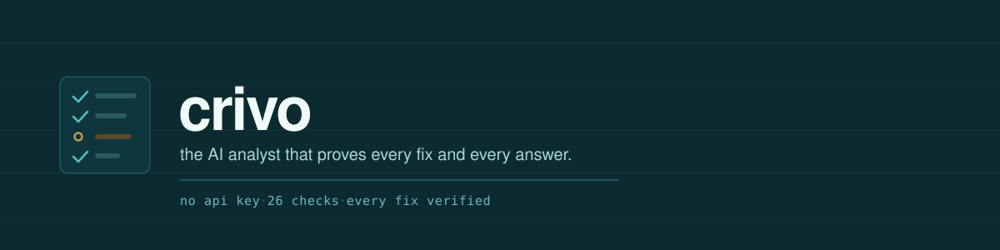

<div align="center">



<br>

**An AI analyst for messy data. It diagnoses, cleans, and answers questions over your tables, and every fix and answer is re-checked before it counts.**

[](https://github.com/aarmens702-hub/crivo/actions/workflows/ci.yml)

[](LICENSE)

[Quickstart](#quickstart) · [How it works](#how-it-works) · [The 26 checks](#the-26-checks) · [Benchmarks](#benchmarks) · [MCP server](#mcp-server) · [CI](#in-ci)

</div>

Most tools will chat with your dataframe. Few of them check whether what came
back was right. crivo does. It reads a messy table, tells you what is broken,
fixes what is safe to fix, answers your questions, and re-runs the check on
every step before it keeps it. A fix that does not pass its re-check is
reverted, not kept.

It has two halves. The **library** (`diagnose`, `clean`, `read`) is plain
Python: no API key, no kernel, nothing to trust yet. The **analyst** is a model
driving an IPython kernel: it writes the pandas that answers your
question or lands the harder fix, and every answer comes back with the code it
ran, the checks that passed, and where the numbers came from.

> **The analyst is not sandboxed by default.** Model-written code runs in a
> subprocess on your machine, as you, with your files (including `.env`) and
> your network. `--docker` runs it in a container with no network instead;
> build the image first with
> `docker build -t analyst-kernel -f docker/Dockerfile .`. The MCP server does
> the same when `CRIVO_MCP_SANDBOX=docker` is set. `crivo.ask` has no sandbox
> option yet. The library half and the GitHub Action never run model code.

## Quickstart

Not on PyPI yet, so install from the repo:

```bash
pip install git+https://github.com/aarmens702-hub/crivo
```

### Diagnose and clean, no key needed

```python
import crivo as cv

df = cv.load_example()          # a small messy sales table; or cv.read("your.csv")
report = cv.diagnose(df)
report
```

```
dataframe — 60 rows × 5 columns

  5 fixable · 0 flagged · 20 signals clear

  d01  numbers-as-strings  [revenue]
        2 number formats in one column (bare 90%, symbol 7%)
        safe to fix automatically · confidence 0.95

  d04  sentinel-missing  [units]
        3/60 values are missing-data tokens ('N/A') masquerading as data
        safe to fix automatically · confidence 0.91

  d06  whitespace-damage  [note]
        4/60 values carry stray whitespace; samples: '  follow up  ', 'double  space', ' padded'
        safe to fix automatically · confidence 0.99

  d07  case-spelling-variants  [region]
        9 distinct values collapse to 4 once case and whitespace are normalised; samples: 'north', 'south', 'NORTH'
        safe to fix automatically · confidence 0.95

  d09  duplicate-rows  [whole table]
        2 of 60 rows are byte-identical repeats of an earlier row
        safe to fix automatically · confidence 1.00

  checked and clean: 2-3, 5, 8, 10-19, 21-26
```

```python
cleaned, summary = cv.clean(df)   # applies the safe fixes, re-checks each one
summary.samples()                 # the receipts: old value, new value, row, per fix
summary.needs_review              # what it would not decide for you (here: dropping rows)
cv.write(cleaned, "clean.parquet")
```

In a notebook, `report` and `summary` render as cards. `report.plot()` draws a
chart of what is wrong per column, and `df.crivo.diagnose()` works as an
accessor once crivo is imported.

### The analyst, with a model key

```bash
echo 'DEEPSEEK_API_KEY=sk-...' > .env       # or CRIVO_PROVIDER=claude + ANTHROPIC_API_KEY
python -m crivo
```

```
/load data/sales.csv sales      load a file as a variable
which region grew the most?     ask in plain English; you approve the code, then it runs
/clean sales                    diagnose, then fix
/why                            where an answer came from, and whether it holds
/skills                         the fixes it has learned and kept
```

Or one question from Python: `cv.ask(df, "which region grew the most?")`
returns an `Answer` with the text, the code, the checks, and the lineage.

## What it does

- **Diagnoses** any table against [26 named checks](#the-26-checks) (25 run on
  a single file; schema drift compares a set of files) and grades each
  finding: safe to fix, fix and confirm, or needs a person.
- **Cleans** the safe ones and re-checks every fix. If the check still fires,
  the fix is reverted and reported instead of kept.
- **Answers questions** in plain English and ships each answer with its code,
  the assertions that passed, and its lineage back to the raw file.
- **Learns.** A fix that worked becomes a reusable skill, but only after it
  passes its own test and a person says yes. Skills that stop working retire.
- **Reads** csv, tsv, parquet, xlsx, json, jsonl, feather, orc, Stata, SAS,
  compressed files, parquet folders, SQL databases, and JSON APIs through one
  `cv.read`, and writes most of them back with `cv.write`.
- **Goes further than one table:** PII detection (`report.pii()`), a
  shareable HTML report (`report.to_html()`), a before/after comparison
  (`cv.compare`), a keyed row diff (`cv.reconcile`), "why did this metric
  change" (`cv.drivers`), messy-Excel layout detection (`cv.analyze_excel`),
  and a reproducible notebook export (`cv.export_notebook`).
- **Plugs in** as an MCP server for Claude Desktop, Claude Code, or Cursor,
  and as a GitHub Action that fails a build on bad data.

## How it works

**One rule.** A fix counts only when the check that found the problem stops
firing, the row count is what it should be, and every column the fix did not
touch is byte-identical to before. If any of that fails, the frame is restored
from a backup and the failure is reported. Nothing is trusted because a rule
ran. It is trusted because the signal went quiet.

**Three grades.** Every finding gets one:

| grade | means | what happens |
| --- | --- | --- |
| `AUTO` | mechanical, no judgement | fixed and re-checked |
| `GATE` | one plausible fix, worth confirming | proposed, re-checked, waits for a yes |
| `HUMAN` | a real judgement call | reported, never decided for you |

**Who decides.** By default, the mechanical fixes crivo has a built-in fixer
for apply on their own, each one re-checked and reverted if it fails. Anything
the model wrote, and every judgement call, stops at a gate where you run it,
send a note back, or skip it. `--autonomy careful` asks before every fix;
`--autonomy report-only` changes nothing. No level lets the model admit a
skill or decide a `HUMAN` finding.

**A trail on every answer.** Provenance is a graph from the raw bytes to the
answer. An answer is trusted only if it is reachable from a raw file through
steps whose checks passed. `/why` prints that path, and says how it broke when
it breaks: "nothing grounds this" and "a step on the path failed" are
different answers.

<details>
<summary><b>How the analyst runs code</b></summary>

<br>

The model runs on the host. It drives an IPython kernel over a small stdio
protocol: a subprocess by default, or a `--network=none` Docker container with
`--docker`. The subprocess is not a sandbox: it runs as you, with your files
and your network. Build the container image once with
`docker build -t analyst-kernel -f docker/Dockerfile .`. Your datasets are
variables in that kernel. The model sees the schema, some statistics, and
truncated samples, never the raw rows. It writes short pandas cells; a
traceback comes back as the next thing it reads. A cleaned dataset is always a
copy with its lineage recorded, and verified fixes survive a kernel crash
through namespace snapshots.

</details>

<details>
<summary><b>How a fix becomes a reusable skill</b></summary>

<br>

After a clean run, each fix the model wrote is rewritten as a general
`fix(df, columns)` and has to earn its place. On the original frozen case it
has to trip the detector, clear it, and leave the rows that were never broken
alone. That last part matters: a "fix" that blanks the whole column also
clears the detector. Its own shipped test has to pass in the kernel. Then a
person says yes.

New skills start on probation: retrieved and applied, but always gated. Three
wins across two different datasets promote a skill; two failures in a row
retire it to `skills/retired/`, kept as evidence. No model decides admission.
The longer version is in [docs/what-this-is.md](docs/what-this-is.md).

</details>

## The 26 checks

Each check is a named detector that either fires with evidence or reports the
column clean. Absence is a checked claim, not a silence.

| | check | catches |
| --- | --- | --- |
| d01 | numbers-as-strings | `$1,200` and `12%` in a column that should be numeric |
| d02 | dates-as-strings | dates stored as text |
| d03 | mixed-date-formats | `03/04/2024` next to `2024-04-03` |
| d04 | sentinel-missing | `N/A`, `-`, `null`, `-999` typed in where a value is missing |
| d05 | suppression-codes | tokens like `<5` mixed into a numeric column |
| d06 | whitespace-damage | leading, trailing, doubled, and non-breaking spaces |
| d07 | case-spelling-variants | `North`, `north`, `NORTH ` as three categories |
| d08 | encoding-mojibake | `café` where `café` was meant |
| d09 | duplicate-rows | exact repeats |
| d10 | near-duplicate-rows | the same record with a small drift |
| d11 | key-violations | an ID column that should be unique and is not |
| d12 | field-contradictions | one zip code, two cities |
| d13 | out-of-domain-values | negative quantities, dates in 2099 |
| d14 | broken-coordinates | swapped or out-of-range latitude and longitude |
| d15 | statistical-outliers | values far outside the column's spread |
| d16 | unit-heterogeneity | kg and lb in the same column |
| d17 | packed-fields | several values crammed into one cell |
| d18 | header-damage | blank, duplicated, or padded column names |
| d19 | empty-constant-columns | columns that are empty or hold one value |
| d20 | schema-drift | columns that change across a set of files |
| d21 | aggregate-rows | a `TOTAL` row sitting in the data |
| d22 | id-numeric-corruption | IDs that lost leading zeros or became floats |
| d23 | boolean-chaos | `yes`, `Y`, `TRUE`, `1` in one column |
| d24 | stray-structural-rows | repeated headers and footer junk from stacked exports |
| d25 | duplicated-columns | the same column twice under different names |
| d26 | truncated-values | values cut off at a length limit or with `...` |

## Benchmarks

Measured with no model and no labels: synthetic datasets with planted damage
plus four public dirty datasets (Raha's hospital, flights, beers, and rayyan),
scored cell by cell against the known truth.

<!-- bench:start -->
**Deterministic mode baseline** (2026-09-07, 1450 synthetic + 4 external datasets, cell-level scoring, 0 labels):

| metric | value |
|---|---|
| detection micro-F1 (mean, silence = 0) | 0.731 |
| repair F1, mean over datasets with repair defined (226/1450; 226 of the 450 fully fixable) | 0.923 |
| survived-verification rate, mean over datasets that attempted a fix (650/1450) | 0.673 |

Full tables: `bench/RESULTS.md`.
<!-- bench:end -->

Survived-verification is the share of attempted fixes that passed their
re-check. The other third were reverted rather than kept, which is the system
working: a fixer that cannot prove its fix refuses it. Reproduce with
`uv run python -m bench.run --full` (the CI smoke run is the default); method and caveats are in
[bench/RESULTS.md](bench/RESULTS.md).

## Models

DeepSeek is the default. The same seam speaks to Anthropic and to any
OpenAI-compatible endpoint, local models included:

```bash
DEEPSEEK_API_KEY=sk-...                       # default provider
CRIVO_PROVIDER=claude ANTHROPIC_API_KEY=...   # Anthropic
CRIVO_PROVIDER=openai \
  CRIVO_BASE_URL=http://localhost:11434/v1 \
  CRIVO_MODEL=qwen3:32b python -m crivo       # Ollama, vLLM, OpenRouter, ...
```

`CRIVO_MODEL` overrides the model on any provider, and `CRIVO_API_KEY` is used
if your endpoint needs one. Slow local endpoints can raise the stream budgets
with `CRIVO_STALL_S` and `CRIVO_MAX_CALL_S`.

## MCP server

`crivo-mcp` exposes crivo as tools to any MCP client. The gates follow the same
rule as everywhere else: safe fixes run, judgement calls come back to a person,
and the calling agent never decides them.

| tool | what it does |
| --- | --- |
| `diagnose_file` | the 26-check report on a file. Keyless and read-only |
| `clean_file` | a headless clean; judgement calls are reported, not decided |
| `open_data` | load a file into a session and get a profile |
| `ask` | answer a question over a session, with checks and lineage |
| `why` | the trail behind a session's answers |
| `close_session` | shut the session down |

## In CI

`crivo diagnose` exits like a linter: `0` clean, `1` findings at or above
`--fail-on` (default `GATE`, meaning anything that needs a person), `2` for a
file it could not read. As a GitHub Action:

```yaml
- uses: actions/checkout@v4
- uses: aarmens702-hub/crivo@v0.1.0
  with:
    path: data/latest-export.csv
    fail-on: GATE
```

Pin a release tag. `@main` moves with every promotion and can change exit codes.

Or anywhere else: `crivo diagnose file.csv --fail-on AUTO --json`.

## Status

Over 1,000 tests pass on Linux and macOS in CI. The library half does no
network, subprocess, or Docker work on import, so it is safe in any notebook
cell. Not on PyPI yet. The plan, stage by stage, lives in
[specs/2026-10-14-the-plan.md](specs/2026-10-14-the-plan.md).

## Repo map

| path | what is there |
| --- | --- |
| `src/crivo/` | the library, the analyst loop, the kernel supervisor, the MCP server |
| `bench/` | the benchmark: corruption injectors, truth manifests, scorer, results |
| `skills/` | skill folders a person admitted (the ledger that activates them is local for now) |
| `specs/` | a design spec for every phase, newest last |
| `docs/` | the longer explanation, the architecture and contract, closed review records |

## Development

```bash
uv sync
uv run pytest                      # the suite
uv run pytest -m docker            # the container tests, opt in
uv run ruff check --fix . && uv run ruff format .
```

## License

MIT. See [LICENSE](LICENSE).
